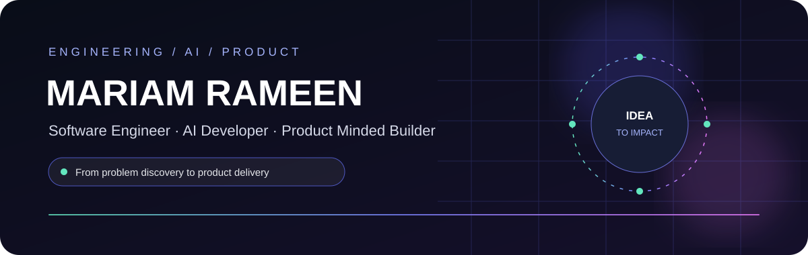
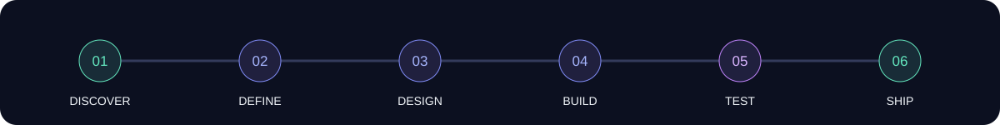
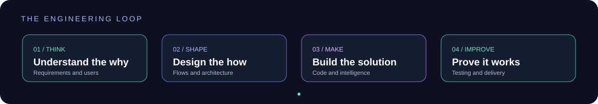
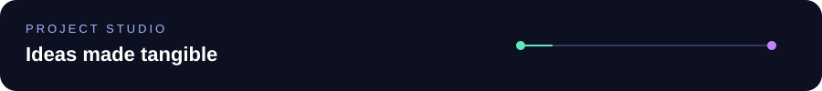
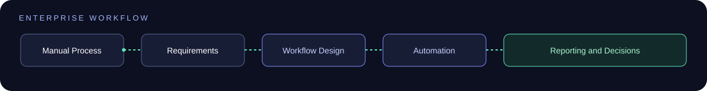
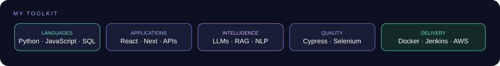
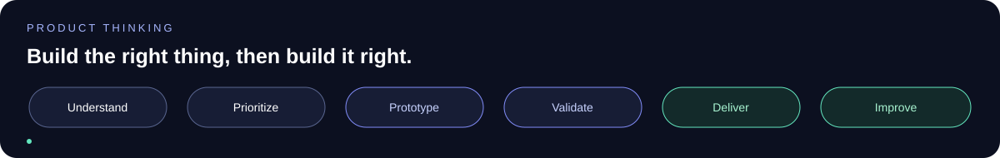

  

&nbsp;

&nbsp;

 

# I BUILD MORE THAN SOFTWARE

### I turn problems into products

**Understand → Design → Build → Test → Ship → Improve**

 

  

## 🧠 HOW I WORK

<table>
<tr>
<td align="center" width="25%">

### DISCOVER

Requirements  
Business Analysis  
User Needs  
Process Analysis  
SRS  
SDS

</td>
<td align="center" width="25%">

### DESIGN

UI UX  
Figma  
Prototyping  
User Flows  
System Thinking  
Product Thinking

</td>
<td align="center" width="25%">

### ENGINEER

Frontend  
Backend  
APIs  
Databases  
Full Stack  
AI Systems

</td>
<td align="center" width="25%">

### DELIVER

Testing  
Automation  
CI CD  
Docker  
AWS  
Deployment

</td>
</tr>
</table>

 

 

## ⚡ WHAT I BUILD

<table>
<tr>
<td width="50%" valign="top">

### 🤖 AI PRODUCTS

LLM Applications  
RAG Systems  
NLP Solutions  
Speech AI  
AI Evaluation  
Intelligent Automation

</td>
<td width="50%" valign="top">

### 💻 FULL STACK SYSTEMS

React Applications  
Next.js Interfaces  
FastAPI Services  
Node.js APIs  
Database Systems  
Enterprise Applications

</td>
</tr>
<tr>
<td width="50%" valign="top">

### 🧪 QUALITY ENGINEERING

API Testing  
Cypress  
Selenium  
Validation  
Debugging  
Quality Focused Development

</td>
<td width="50%" valign="top">

### 🚀 DELIVERY

Docker  
Jenkins  
CI CD  
AWS  
Git  
GitHub  
Deployment Workflows

</td>
</tr>
</table>

 

## 🚀 SELECTED BUILDS

 

### 🎙️ BANDITUP

## AI IELTS PREPARATION PLATFORM

A full stack AI learning platform combining conversational AI, speech technology, adaptive learning and RAG.

**AI**

GPT 4o · Whisper · Azure Speech · Azure TTS · RAG · LLM Evaluation

**Product**

Speaking Assessment · Personalized Feedback · Adaptive Learning · Mock Tests · AI Tutor · Learning Analytics

**My work included**

Requirements Engineering · SRS and SDS · UI UX Prototyping · Full Stack Development · Speech Evaluation · AI Generated Feedback · RAG Architecture · Adaptive Learning

 

---

### 🩺 SEHATSAATHI AI

## BILINGUAL AI ASSISTANT

A conversational AI application designed around Urdu and English interaction with speech capabilities.

**React · Node.js · MongoDB · GPT 4o mini**

Conversational AI · Speech to Text · Text to Speech · Bilingual Interaction · AI User Experience · Full Stack Development

 

---

## 🏢 ENTERPRISE ENGINEERING

### HBL MICROFINANCE BANK

My professional engineering work focused on transforming manual business processes into centralized digital workflows.

### INSURANCE INTELLIGENCE

Manual insurance processes transformed into a centralized workflow for:

Claim Tracking · Document Verification · Reporting · Reconciliation · Email Alerts · Decision Support · Data Analytics

### PROCUREMENT AUTOMATION

A workflow designed to automate:

Email Information Collection · Request Processing · Quotation Handling · Quotation Comparison · Approval Tracking · Procurement Reporting

The source code for this work remains on organizational infrastructure.

 

## 🧩 MY ENGINEERING RANGE

<table>
<tr>
<td align="center">

🧠

 

**REQUIREMENTS**

 

SRS  
SDS  
Business Analysis  
Process Mapping

</td>
<td align="center">

🎨

 

**PROTOTYPING**

 

Figma  
UI UX  
User Flows  
Product Design

</td>
<td align="center">

💻

 

**DEVELOPMENT**

 

React  
Next.js  
FastAPI  
Node.js

</td>
</tr>
<tr>
<td align="center">

🤖

 

**AI**

 

LLMs  
RAG  
NLP  
Speech AI

</td>
<td align="center">

🧪

 

**TESTING**

 

Cypress  
Selenium  
API Testing  
Debugging

</td>
<td align="center">

🚀

 

**DEVOPS**

 

Docker  
Jenkins  
AWS  
CI CD

</td>
</tr>
</table>

 

 

## 🛠️ TECHNOLOGY

  

**AI**

LLMs · RAG · NLP · Prompt Engineering · Vector Databases · Speech AI

 

## 📦 MORE THAN A DEVELOPER

I enjoy being involved before the code begins.

I like understanding the problem, talking through requirements, shaping the user experience, deciding what the system should actually do, building it, testing it and thinking about how it can be improved.

That is why my interests sit across:

### Engineering · AI · Product

 

 

## 🎯 WHAT I AM INTERESTED IN

<table>
<tr>
<td align="center" width="33%">

### PRODUCT ENGINEERING

Building useful products

Understanding users

Turning ideas into systems

</td>
<td align="center" width="33%">

### AI ENGINEERING

Intelligent applications

LLM systems

Automation

AI powered experiences

</td>
<td align="center" width="33%">

### PRODUCT THINKING

Requirements

Prioritization

Workflows

Product strategy

</td>
</tr>
</table>

 

## 🎓 EDUCATION

### BS SOFTWARE ENGINEERING

**COMSATS University Islamabad**

2022 to 2026

 

## 💼 EXPERIENCE

### HBL MICROFINANCE BANK

**Software Engineering and AI Intern**

Enterprise Automation  
Requirements Analysis  
AI Decision Support  
Full Stack Development  
Workflow Automation  
Data Analytics

### INFINITY SOFTWARES

**MERN Stack Intern**

Full Stack Development  
REST APIs  
Frontend Development  
Database Operations  
Debugging

 

  

